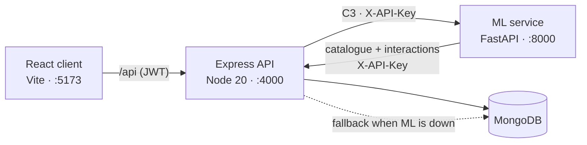

# LEAP — Learning Engine for Adaptive Personalization

**An AI-powered e-learning system that learns what you know, recommends what you should
learn next, and tells you why.**

Capstone II (CS 4191) · Team 35 · NIIT University · AY 2026-27 · Mentor: Prof. Manish Hurkat

[](https://github.com/garvitbajajj/LEAP/actions/workflows/ci.yml)

| Member | Enrolment | Vertical |
|---|---|---|
| Garvit Bajaj | BT23GCS163 | V1 — Identity, Access & Platform Foundation |
| Dhruvika Bansal | BT23GCS104 | V2 — Content Catalogue & Discovery |
| Abhishek Vijay Kakde | BT23GDS103 | V3 — Personalised Recommendations & Feed |
| Taher Mohammed Husain Aurangabadi | BT23GCS178 | V4 — Learning Path, Mastery & Analytics |

Work is split by **feature vertical**, not by role: every member builds frontend, backend,
ML and DevOps within their vertical. See [`docs/LEAP_Work_Division.docx`](docs/LEAP_Work_Division.docx).

---

## What it does

- **Hybrid recommendations** — five signals blended per learner: ALS latent factor
  collaborative filtering (Hu-Koren-Volinsky implicit matrix factorisation), TF-IDF content similarity,
  skill-gap fit, completed prerequisites and popularity.
- **Cold start** — new learners are ranked from their onboarding goal until they have history.
- **Diversity** — Maximal Marginal Relevance re-ranking with a per-topic cap.
- **An explanation on every recommendation** — e.g. *"Builds on Control Flow, which you
  completed, and develops Python basics for your Data Analyst goal"*, with a factor breakdown.
- **Adaptive learning paths** — topologically ordered over a prerequisite DAG, with cycle
  detection on every catalogue write.
- **Mastery tracking** — Bayesian Knowledge Tracing, with damping so retaking a quiz cannot farm mastery.
- **Server-graded quizzes** — answer keys never reach the browser.
- **Graceful degradation** — if the ML service is down, the feed falls back to a popularity
  ranking behind a circuit breaker instead of erroring.
- **Five authentication schemes** in Swagger — Basic, opaque Bearer, JWT, API key and OAuth 2.0.

## Architecture



Interfaces between the verticals are frozen JSON Schemas in [`contracts/`](contracts/).

## Run it locally

Prerequisites: Node 20+, Python 3.11+, MongoDB running on `localhost:27017`.

```bash
# 1. API server - terminal 1
cd server
npm install
cp .env.example .env
npm run seed        # demo catalogue, accounts and learner history
npm start           # http://localhost:4000
```

```bash
# 2. ML service - terminal 2
cd ml
pip install -r requirements.txt
python -m uvicorn app.main:app --port 8000
```

```bash
# 3. Web client - terminal 3
cd client
npm install
npm run dev         # http://localhost:5173
```

Or with Docker:

```bash
docker compose up -d --build
docker compose --profile seed run --rm seed
# app on http://localhost:8080
```

### Demo accounts

| Role | Email | Password |
|---|---|---|
| Learner | `learner@leap.dev` | `Learner@123` |
| Instructor | `instructor@leap.dev` | `Instructor@123` |
| Admin | `admin@leap.dev` | `Admin@1234` |

The login page has one-click buttons for each.

## API documentation

| | |
|---|---|
| Swagger UI | http://localhost:4000/api/v1/docs |
| OpenAPI JSON | http://localhost:4000/api/v1/openapi.json |
| ML service docs | http://localhost:8000/docs |

| Scheme | Type | Protects |
|---|---|---|
| `basicAuth` | HTTP Basic | `POST /admin/bootstrap` |
| `bearerAuth` | Opaque bearer token | `GET /internal/status` |
| `jwtAuth` | JWT bearer | all learner, instructor and admin endpoints |
| `apiKeyAuth` | `X-API-Key` header | `GET /internal/catalogue`, `/internal/interactions`, all ML endpoints |
| `oauth2` | Google authorization code | `GET /auth/google` |

## Tests

```bash
cd server && npm test           # Jest - 41 tests
cd ml     && python -m pytest   # pytest - 16 tests
cd client && npm test           # Vitest - 8 tests
```

All three suites run on every push via [GitHub Actions](.github/workflows/ci.yml), and in the
[`Jenkinsfile`](Jenkinsfile) pipeline alongside image builds and deployment.

## Repository layout

```
client/      React 18 + Vite web app, Nginx config for production
server/      Express API: auth, catalogue, events, path, recommendations, analytics, Swagger
ml/          FastAPI recommender: hybrid ranking, MMR, explanations
contracts/   Frozen JSON Schemas (C1-C5) between the verticals
docs/        SRS, SDD, presentation, work division, checklist, deferred items
Jenkinsfile  Declarative CI/CD pipeline
docker-compose.yml
```

## Roadmap

Three items per member are scheduled for the next milestone — see [`docs/DEFERRED.md`](docs/DEFERRED.md).
